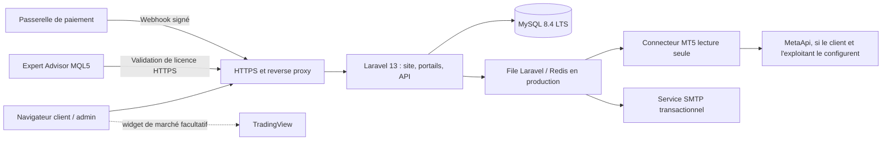

# FASO DIGITAL TRADING — architecture de travail

> **Statut : provisoire.** Le cahier des charges annoncé n'est pas présent dans le workspace. Cette architecture s'appuie sur le site public fourni et sur un ancien socle NEXUS trouvé dans un autre dossier. Elle devra être comparée au cahier dès qu'il sera disponible.

## Périmètre retenu pour le premier socle

- Site public, catalogue d'abonnements, comptes client, espace partenaire et administration.
- Abonnements, paiements confirmés par fournisseur, commissions et licences de robots MT5.
- Option de statistiques MT5 en lecture seule via une intégration explicitement configurée.
- Le robot s'exécute dans le terminal MT5 du client. Cette architecture ne place pas d'ordres à distance et ne garde pas les fonds des clients.
- Aucune performance projetée ou cotation indicative ne sera présentée comme une donnée réelle. Les données de compte ne s'affichent qu'après une synchronisation réelle réussie.

## Architecture applicative

Monolithe modulaire Laravel, avec une application web et des points d'API versionnés. Les tâches lentes et les traitements de webhooks passent par la file Laravel; les intégrations sont encapsulées derrière des contrats distincts pour qu'une panne fournisseur n'altère pas les autres modules.

### Choix techniques

| Couche | Choix |
|---|---|
| Backend | PHP 8.5 et Laravel 13 |
| Base relationnelle | MySQL 8.4 LTS en production; SQLite seulement pour le développement local et les tests |
| Interface | Blade et CSS du produit; JavaScript limité aux interactions nécessaires |
| API du robot | REST HTTPS, versionnée, signée et limitée en débit |
| Tâches | Laravel Queue; Redis recommandé en production pour les synchronisations |
| Graphiques | Affichage de snapshots réels de compte; aucun jeu de données généré |
| Déploiement | Laravel Cloud, région EU Central (Frankfurt) retenue; runtime PHP géré, MySQL géré, HTTPS automatique et secrets d’environnement. Les justificatifs doivent utiliser un bucket privé avant la mise en ligne. |
| Contrôles | PHPUnit, `composer audit`, CI, sauvegarde chiffrée et procédure de restauration vérifiée |

Laravel 13 requiert PHP 8.3 minimum. La sélection de PHP 8.5 suit la version disponible dans l'environnement et la période de support PHP publiée. MySQL 8.4 est la filière LTS retenue. Voir [support PHP](https://www.php.net/supported-versions.php), [support Laravel](https://laravel.com/framework/docs/releases) et [cycles LTS MySQL](https://dev.mysql.com/doc/refman/8.4/en/mysql-releases.html).

## Modules

1. **Public** : accueil, offres, risques, contact et pages légales administrables.
2. **Identité** : inscription, sessions sécurisées, récupération d'accès, rôles et MFA administrateur.
3. **Catalogue et abonnements** : prix versionnés, souscriptions et échéances.
4. **Paiements** : fournisseur sélectionné par configuration, redirection hébergée, webhooks vérifiés, traitement idempotent et rapprochement du montant/devise.
5. **Licences** : émission de clés, hash en base, liaison au couple MT5 login/serveur par HMAC dédié et validation depuis MQL5.
6. **Comptes MT5** : identifiant fournisseur et jeton restreint chiffré; synchronisation asynchrone, historique et equity uniquement après réponse réelle validée.
7. **Partenaires** : parrainages et commissions calculées à 10 % après paiements confirmés, renouvellements compris. Le versement des commissions n'est pas intégré.
8. **Administration et support** : offres, abonnements, lecture des commissions, brokers, demandes, tickets, contenu, événements de sécurité et journal d'audit. Les versements de commissions ne sont pas commandés par l'application.

## Schéma de données

| Domaine | Tables du socle actuel |
|---|---|
| Identité et contrôle d'accès | `users`, `sessions`, `password_reset_tokens`, `security_logs`, `audit_logs`; rôles, MFA admin et révision de mot de passe portés par `users` |
| Catalogue | `subscription_plans`, `subscriptions` avec instantané du nom, prix, devise, durée et limites à la souscription |
| Paiement | `payments`, `payment_webhook_events`, `subscription_orders`, `manual_payment_submissions` (références, preuve privée, empreinte SHA-256, décision admin MFA et accusé de réception des conditions) |
| Licences | `licenses`, `license_account_bindings` |
| MT5 | `brokers`, `trading_accounts`, `trades`, `open_positions` (état courant), `position_snapshots` (historique append-only), `performance_snapshots` |
| Partenaires | `partners`, `referrals`, `commissions` (calcul et suivi, sans versement intégré) |
| Demandes de titres BRVM | `brvm_purchase_requests` (demandes non exécutables, sans cotation sous licence ni transmission à Coris) |
| Support, consentement et contenu | `contact_requests`, `support_tickets`, `support_messages`, `notifications`, `site_settings`; versions de consentement dans `users` et `contact_requests` |

Contraintes principales : événement de webhook unique par fournisseur et identifiant; transaction unique par fournisseur; deal unique par compte MT5 et identifiant externe; une commission au plus par paiement; compte lié uniquement par son propriétaire. Montants stockés en `DECIMAL` avec code devise; dates en UTC. Les clés de licence sont hachées. Les jetons d'accès fournisseur sont chiffrés, cachés des sérialisations et jamais journalisés.

## Dépendances externes et coûts à anticiper

| Service | Utilisation | Coût potentiel |
|---|---|---|
| MetaApi, facultatif | Données MT5 en lecture seule | Offre Regular affichée à 30 USD/mois avec un compte inclus et consommation API en supplément; Extended à 100 USD/mois. Prix et disponibilité à reconfirmer avant activation. [Tarifs MetaApi](https://metaapi.cloud/) |
| Crypto, transfert manuel | Binance-Peg BSC-USD sur BNB Smart Chain; capture seule envoyée au serveur, puis revue admin MFA; activation et licence après contrôle | Aucun RPC ou API d'explorateur blockchain n'est intégré. L'administrateur vérifie manuellement le hash, le contrat, le destinataire, le montant et les confirmations. La capture est jointe au mail admin lorsque SMTP est prêt. |
| TradingView, facultatif | Widgets de marché dans le site public | Widgets avec attribution disponibles gratuitement; droits de données temps réel à confirmer auprès des fournisseurs de marché. [Widgets TradingView](https://www.tradingview.com/widget/) |
| Hébergement, email, stockage, supervision | Exploitation, vérification d'adresse, récupération de compte, journaux et sauvegardes | Facturation selon région, volume, rétention et niveau de service; le total sera chiffré après choix de l'hébergeur et du trafic cible. |

### Hébergement retenu

Laravel Cloud est le choix pour le premier déploiement, en EU Central (Frankfurt). L’application sera publiée depuis un dépôt Git privé, avec une base Laravel MySQL et un bucket privé S3-compatible pour les preuves de paiement. Les secrets seront saisis dans l’environnement Laravel Cloud, jamais commités. Les sauvegardes MySQL et TLS sont gérés par la plateforme. Le remote GitHub est configuré localement, mais le compte/lien Laravel Cloud, le domaine public et le bucket ne sont pas encore configurés. `ManualPaymentProofStorage` et l’adaptateur Flysystem S3 sont prêts; l’accès de dépôt restera bloqué en production jusqu’à la configuration et au test du bucket privé et de sa persistance. Les nouvelles commandes utilisent uniquement Binance-Peg BSC-USD; les éventuelles factures PayDunya déjà émises doivent être rapprochées séparément.

Le site public montre des coordonnées `+226`; le Burkina Faso est donc une hypothèse de travail, pas une décision confirmée. Aucun coût total n'est fiable tant que le pays, le nombre de comptes MT5 et les moyens d'encaissement ne sont pas confirmés.

## Intégration MT5 et données financières

- L'EA appelle l'API de licence via `WebRequest` HTTPS avec le login MT5 et le nom de serveur; le serveur ne garde que leur HMAC. L'utilisateur doit autoriser le domaine dans les options Expert Advisors de son terminal; MetaQuotes indique que `WebRequest` est synchrone et indisponible dans le Strategy Tester. [Référence MQL5 WebRequest](https://www.mql5.com/en/docs/network/webrequest).
- Le portail n'accepte aucun mot de passe principal, OTP ou PIN MT5. Pour MetaApi, l'accès lecture seule exige une configuration côté fournisseur avec un mot de passe investisseur; la connexion ne sera activée que si le mode de provisionnement respecte ce principe et si un jeton restreint est fourni. [FAQ MetaApi](https://metaapi.cloud/docs/client/faq/).
- Prérequis de mise en service : source et build EA `.mq5`, compte MetaApi si retenu, jeton de lecture autorisé, login MT5 et serveur vérifiés, compte appartenant à l'exploitant, clé `LICENSE_BINDING_KEY`, domaine HTTPS contrôlé, configuration de paiement USDT BEP20 vérifiée par l'exploitant, processus admin de contrôle des transactions, mentions légales et conditions approuvées. PayDunya sert uniquement au rapprochement d'éventuelles transactions historiques.
- Les résultats historiques issus du compte synchronisé sont séparés des exemples marketing. Pas de cotations, prévisions ou profits synthétiques.

## Risques et contrôles

- **Vol de secrets** : chiffrement au repos, secret manager, scopes minimaux, exclusion des logs et rotation.
- **Faux webhooks/doublons** : signature fournisseur, vérification de statut côté fournisseur, montant/devise, clé d'idempotence et journal immuable.
- **Accès inter-comptes (IDOR)** : policies au niveau de chaque requête et tests d'accès négatif.
- **Abus de licences** : clés aléatoires hachées, limites de débit, révocation, liaison contrôlée au compte et audit.
- **Indisponibilité/rate limits fournisseur** : retries bornés en queue, états « en attente/erreur », aucune valeur de repli inventée.
- **Données financières trompeuses** : afficher source, horodatage, période et devise; aucun rendement garanti ni projection.
- **Perte de données** : sauvegardes chiffrées hors serveur et exercice de restauration avant production.
- **Exposition d'admin** : MFA TOTP, moindre privilège, session sécurisée, audit des actions sensibles.

## Phases et critères de sortie

0. **Cadrage** : récupérer le cahier, confirmer marque, exploitant et pays; préciser les capacités de l'EA.
1. **Socle et catalogue** : terminé dans ce dépôt; Laravel, migrations, catalogue, consentement, pages légales et administration des offres.
2. **Licences** : API login/serveur, clé HMAC dédiée, intégration du robot et validation sur un terminal autorisé restent à finaliser avec la source EA et les accès d'exploitation.
3. **Paiement** : le client soumet uniquement la capture. L’administrateur enregistre et contrôle le hash, le contrat BSC-USD, le destinataire, le montant et les confirmations avant activation. La plateforme n’interroge pas la blockchain et ne valide jamais seule une preuve image. PayDunya reste pour les transactions historiques.
4. **MT5 lecture seule** : adaptateur MetaApi réel présent; connexion et synchronisation restent non validées sans compte et jeton de lecture autorisés.
5. **Préproduction** : revue sécurité, restauration MySQL, alertes, supervision, tests de charge et déploiement vérifié à réaliser.

Une phase dépendante d'un service externe reste bloquée jusqu'à réception des accès autorisés et réussite des vérifications réelles. Un test unitaire ne sera jamais présenté comme une connexion réelle.

## Environnement de cette session

Le nouveau projet est dans `outputs/black-wolf-trading`. Le workspace initial n'avait ni code ni dépôt Git. PHP 8.5 et Composer ont été trouvés dans le runtime local d'un ancien travail; Docker et npm ne sont pas disponibles via le `PATH` actuel. Le cahier des charges n'a pas été trouvé; l'ancien projet a été copié sans son `.env`, sa base SQLite ni ses journaux, et son dossier original n'a pas été modifié.

### État des premiers jalons

- Le projet Laravel 13 a été installé et renommé; l'ancien fournisseur de paiement fictif, les réponses MT5 simulées et les estimations de gains ne sont plus actifs.
- Le catalogue comprend les dix formules observées sur le site public. Les montants sont provisoires jusqu'à confirmation du propriétaire. Le seeder ajoute seulement les formules absentes et ne modifie aucun prix existant.
- Les offres sont éditables par un admin MFA; les changements sont audités et ne modifient pas les conditions des souscriptions déjà enregistrées.
- La validation de licence utilise le login MT5 et le nom du serveur; les identités sont protégées par une clé HMAC dédiée et la validation renvoie 503 si cette clé n'est pas configurée.
- Les migrations conservent l'historique des positions, empêchent leur suppression avec celle du compte, journalisent les contrôles d'abonnement, distinguent les renouvellements, empêchent le rejeu d'un code TOTP et normalisent les nouveaux parrainages à 10 %. Elles sont appliquées dans la base locale après création et contrôle d'une sauvegarde; tout déploiement doit suivre la même procédure de sauvegarde préalable.
- Le site affiche un widget TradingView côté navigateur pour l'or et certains titres américains; aucune cotation ou prévision synthétique n'est créée. Paiement et MetaApi restent désactivés sans configurations et tests externes réels.
- Le formulaire de contact et l'inscription enregistrent l'heure et la version du consentement. Un administrateur MFA peut filtrer et suivre l'état des demandes; chaque changement de statut est audité. Les pages de mentions légales signalent les données d'exploitant manquantes; leur contenu reste à valider avant commercialisation.
- L'inscription demande une vérification d'adresse avec lien signé à durée limitée; les espaces privés sont fermés avant confirmation. La récupération du mot de passe utilise le broker Laravel, un courriel FASO DIGITAL TRADING et des réponses qui ne révèlent pas si l'adresse existe. Le changement de mot de passe avance une révision de session. Le SMTP transactionnel doit être configuré avant l'ouverture publique.
- Le processeur historique PayDunya peut rapprocher une ancienne transaction confirmée; les nouvelles commandes utilisent USDT BEP20 et une vérification admin manuelle. Les tests locaux valident les règles de renouvellement sans appel réseau blockchain.
- Les paiements de commission ne sont pas versés automatiquement. Le processeur métier peut inverser une commission non versée après réception d'un événement de remboursement normalisé, mais l'adaptateur PayDunya actuel ne produit pas cet événement; le remboursement réel reste à rapprocher manuellement.
- Les états de préparation SMTP, PayDunya, MetaApi, BRVM/Coris et TradingView sont affichés dans le tableau de bord admin; ces états ne remplacent pas un test de production.
- `artisan db:show --counts` ne fonctionne pas dans l'environnement local car l'extension PHP `intl` n'est pas installée; les tables et volumes ont été contrôlés directement via SQLite.
